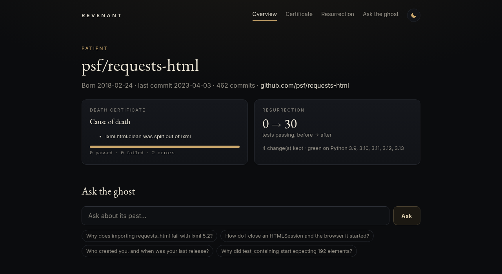
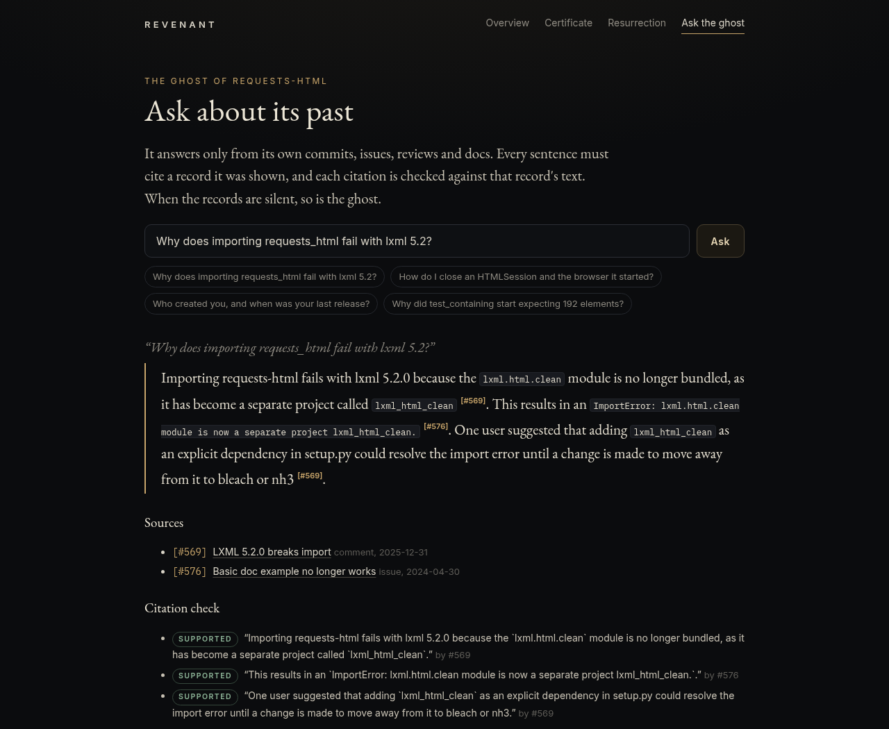
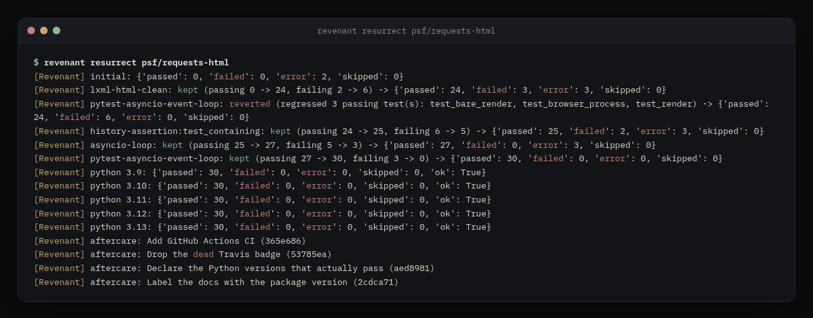
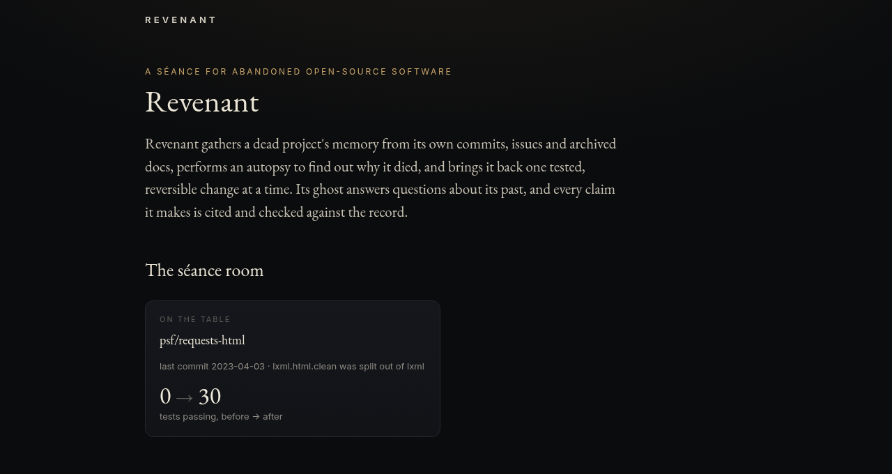
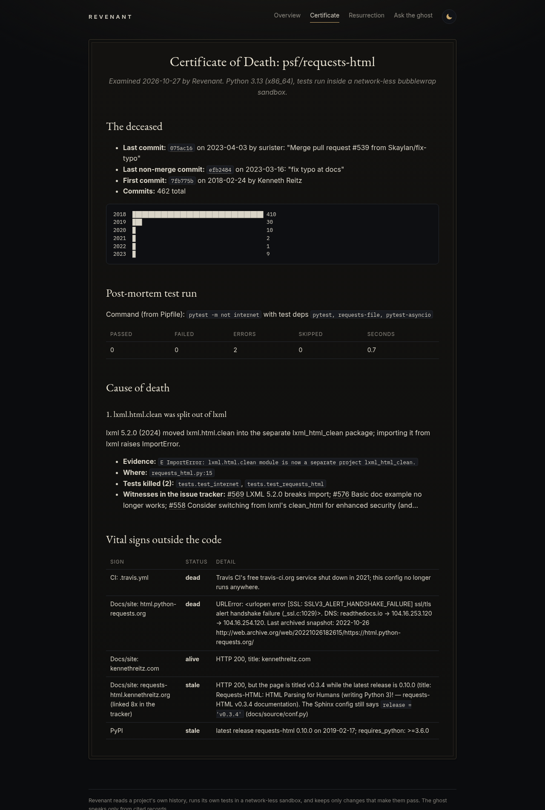
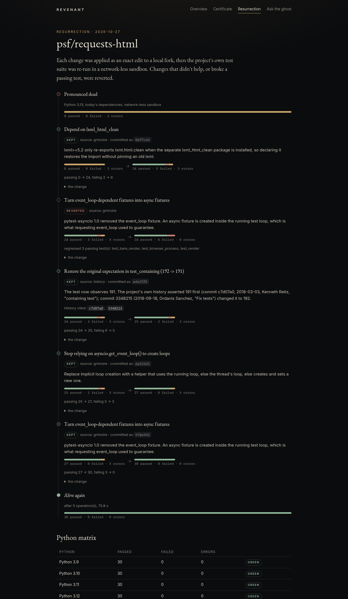
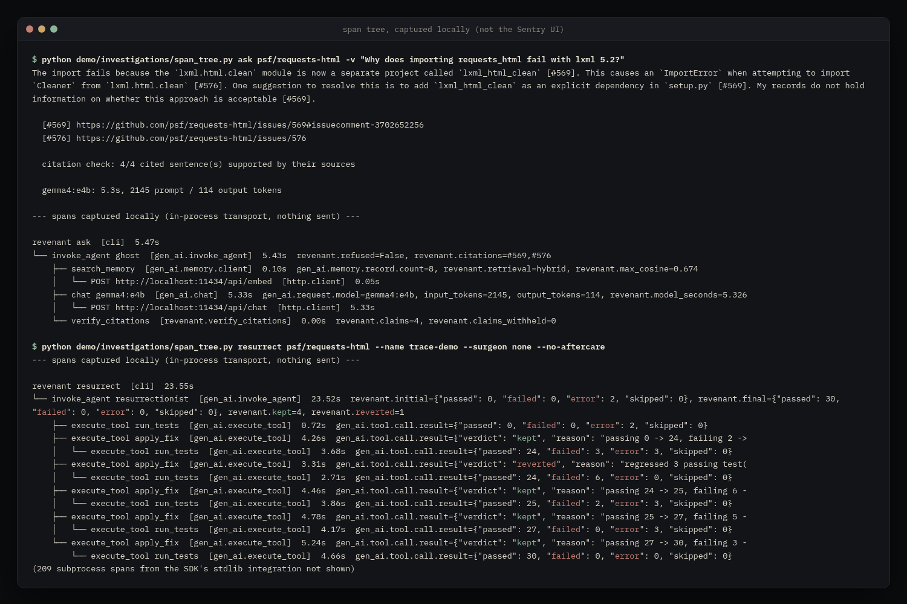

# Revenant

*A séance for abandoned open-source software.*

> Project started **Oct 27, 2026**.

Every dead repository still has a voice: thousands of commits, issues, reviews and docs written by
the people who kept it alive. Revenant gathers that voice, lets you **talk to the ghost** of the
project, performs an **autopsy** to find out what actually killed it, and then attempts a
**resurrection**: one small, verified edit at a time, each one judged by the project's own test suite.

The first patient is [`psf/requests-html`](https://github.com/psf/requests-html) (last release
0.10.0, February 2019). On today's Python it does not even import.

| | before | after |
|---|---|---|
| test suite (Python 3.13, today's dependencies) | 0 passed, 2 collection errors | **30 passed, 0 failed** |
| Python 3.9 / 3.10 / 3.11 / 3.12 / 3.13 | – | 30 / 30 / 30 / 30 / 30 passing |
| CI | `.travis.yml` (travis-ci.org shut down in 2021) | GitHub Actions workflow, weekly cron |
| docs site | `html.python-requests.org`: TLS failure; Wayback shows "Domain Suspension" by 2022-10-26 | archived 2019 docs ingested into the ghost's memory |

All numbers in this README come from runs saved under [`demo/`](demo/). The screenshots in
[`docs/`](docs/) were taken with headless Chromium by
[`scripts/screenshots.py`](scripts/screenshots.py), from the running web UI and those outputs.



**Live demo:** <https://revenant-zaq3.onrender.com> (Render free tier: the first request after it
has been idle can take about 30–60 s; see [Live on Render](#live-on-render-free-tier)).

## The three rites

### 1. Summon: build the ghost's memory

```
revenant summon psf/requests-html
```

Clones the repo, harvests issues, PRs, comments and reviews from the GitHub API (cached on disk,
resumable when rate-limited), and stores **2,810 documents** (462 commits, 693 issues, 235 PRs,
1,368 comments, 21 reviews, 29 doc pages, 2 records) in SQLite with an FTS5 index and
**EmbeddingGemma** vectors.

Dead documentation can be raised too:

```
revenant summon psf/requests-html --archive https://web.archive.org/web/20190915235734/http://html.python-requests.org:80/
```

The snapshot is fetched through the **Browserbase** Fetch API when `BROWSERBASE_API_KEY` is set (direct
otherwise), cached on disk so every page is fetched once, and becomes citable as
`[archive:html.python-requests.org@2019-09-15]`.

### 2. Ask the ghost

```
$ revenant ask psf/requests-html -v "Why does importing requests_html fail with lxml 5.2?"
Importing requests-html fails because the `lxml.html.clean` module is now a separate project
called `lxml_html_clean` [#569]. This causes an `ImportError` when attempting to import `Cleaner`
from `lxml.html.clean` [#576]. ...

  [#569] https://github.com/psf/requests-html/issues/569#issuecomment-3702652256
  [#576] https://github.com/psf/requests-html/issues/576

  citation check: 4/4 cited sentence(s) supported by their sources

  gemma4:e4b: 7.2s, 2145 prompt / 117 output tokens
```

The ghost is **Gemma 4 E4B** (via Ollama, thinking off), answering in first person from its own
history. It follows strict rules:

- Retrieval is hybrid (BM25 + EmbeddingGemma cosine, fused with reciprocal rank fusion).
- If nothing relevant is retrieved (max cosine < 0.30), it refuses **without calling the model**:
  *"The spirits are silent. Nothing in my records speaks to that."*
- Every citation must name a record that was actually retrieved. Invented refs are stripped.
- Every cited sentence is then checked against the text of the records it cites (below).
  Unsupported citations are removed, sentences with no supporting record are withheld, and an
  answer with nothing supported left becomes a refusal.

`--model backboard:<provider>/<model>` gives the ghost a hosted voice instead
([`demo/17_ghost_backboard.txt`](demo/17_ghost_backboard.txt): Dots3-Note Preview, 3/3 and 2/2
sentences supported, about 20 s and a reported $0 per answer).

#### The citation check

[`revenant/citecheck.py`](revenant/citecheck.py) splits the answer into sentences and keeps
trailing citations with the sentence they follow. A sentence counts as supported by a cited
record when:

- every **hard detail** in it appears verbatim in one of its cited records: version numbers, dates,
  years, SHAs, issue numbers, `code spans`, quoted text and dotted, underscored or camelCase
  identifiers (the project's own name excepted), **and**
- that record shares at least half of the sentence's content words (after light stemming), or a
  third of them if the record also carries one of the sentence's hard details, or the sentence is
  little more than that detail.

The check is lexical. It uses no model and is covered by 13 tests. It is strict on purpose, so it
has false negatives. A sentence about 0.9.0 that was probably fine was withheld because only 20%
of its other words were in the record it cited
([`demo/09_ghost_archive.NOTE.md`](demo/09_ghost_archive.NOTE.md)). It cannot judge paraphrase or
negation either: "My records do not hold information on whether this approach is acceptable [#569]"
passes. The answers saved before the check existed are in
[`demo/before_support_check/`](demo/before_support_check/), and
[`demo/16_recheck_saved_answers.txt`](demo/16_recheck_saved_answers.txt) replays them through it.
In the old archive answer, it removes the one sentence that credits "0.9.0" to the archived
docs, which don't contain it.



### 3. Autopsy and resurrection

```
revenant autopsy psf/requests-html      # writes a death certificate
revenant resurrect psf/requests-html    # fixes it on a local branch
```

The **autopsy** runs the project's own tests (the command comes from its Pipfile) inside a
**bubblewrap sandbox with no network**. It classifies the failures and finds witnesses in the issue
tracker. It also checks vital signs outside the code: CI config, docs hosts (DNS via DoH, TLS, page
title vs. latest release, last Wayback snapshot) and PyPI metadata. See
[`demo/death_certificate.md`](demo/death_certificate.md).

The **resurrection** loop:

1. Re-run the suite and classify what is failing.
2. Pick a cure. The **grimoire** (known, explainable cures for common causes of death) goes first,
   then the **surgeon**, **Qwen2.5-Coder 7B**, which may only answer with exact SEARCH/REPLACE edits
   to files it was shown.
3. Apply the edit only if every SEARCH block matches exactly once. Re-run the full suite in the sandbox.
4. Keep the edit and commit it if tests improved and **no passing test regressed**. Otherwise `git reset --hard`.
5. When the suite is green: verify across Python 3.9–3.13, then aftercare. Aftercare adds GitHub
   Actions CI, removes the dead Travis config and badge, declares the Python versions that actually
   pass, and fixes the docs release label.

Everything is logged to [`RESURRECTION_LOG.md`](demo/RESURRECTION_LOG.md), with diffs and verdicts,
including what was reverted.



The autopsy's terminal output is in [`docs/term-autopsy.png`](docs/term-autopsy.png), and the web
UI's certificate and resurrection timeline are in
[`docs/web-certificate.png`](docs/web-certificate.png) and
[`docs/web-resurrection.png`](docs/web-resurrection.png).

## What killed requests-html

| # | cause | where | cure |
|---|---|---|---|
| 1 | lxml 5.2 (2024) split `lxml.html.clean` into `lxml_html_clean`; the import fails | `requests_html.py:15` | depend on `lxml_html_clean` |
| 2 | `asyncio.get_event_loop()` no longer creates loops implicitly | `HTMLSession.browser`, `AsyncHTMLSession.__init__` | helper: running loop, else this thread's loop, else a new one |
| 3 | pytest-asyncio 1.0 removed the `event_loop` fixture | `tests/test_requests_html.py` | async fixture via `pytest_asyncio.fixture` |
| 4 | `test_containing` expects 192 elements, finds 191 | test | restore 191, citing history (below) |

The grimoire's first try at cure 3 **regressed three render tests**, so it was reverted. Once cure 2
landed, the loop gave it one more chance and it took the suite from 27 to 30 passing. The regression
guard is the point: nothing that breaks a passing test survives.

### The truth about 191 vs 192

[`demo/investigations/191_vs_192.py`](demo/investigations/191_vs_192.py) ([output](demo/investigations/191_vs_192.out.txt)) shows:

- `== 191` was written by Kenneth Reitz in `c7d07a0` (2018-03-03, "containing test").
- `3348215` (2018-09-18, "Fix tests") changed it to 192. It reached master through PR #146.
- The fixture `tests/python.html` has not changed since 2018-02-26 (pure ASCII, 48,883 bytes).
- 237 historical versions of `requests_html.py` were run against it. 82 still run today: 80 find
  **191**, and the only other result, 529, comes from two versions older than the test itself.
- lxml 4.9.4, 5.1.1, 5.3.0 and 6.0.0 all give 191. **No environment tried produced 192.**

The history-based cure therefore restores 191 and cites both commits. The code-model surgeon,
run alone, made the same one-character change, but with no evidence for it. Compare
[`demo/RESURRECTION_LOG.md`](demo/RESURRECTION_LOG.md) with
[`demo/RESURRECTION_LOG_surgeon_only.md`](demo/RESURRECTION_LOG_surgeon_only.md).

## Head-to-head: grimoire vs. local and hosted open-weight surgeons

Same patient, same sandbox, same judge. The code models ran with `--no-grimoire`, so every edit
came from them. Tokens, time and cost are as reported by Ollama and Backboard. Details, caveats and
the full logs are in [`demo/14_head_to_head.md`](demo/14_head_to_head.md).

| contender | passing (of 30) | kept / reverted / unappliable | model calls | tokens in / out | model time | cost reported |
|---|---|---|---|---|---|---|
| grimoire only (no model) | **30** | 4 / 1 / 0 | 0 | – | 0 s (24.6 s wall) | – |
| Qwen2.5-Coder 7B, local (Ollama, CPU) | **25** | 2 / 2 / 3 | 10 | 8,902 / 852 | 141.6 s | n/a (local) |
| Dots3-Note Preview 280B-A16B, via Backboard | **27** | 3 / 6 / 0 | 10 | 7,856 / 44,501 | 532.7 s | $0.0000 |
| Flint v1.0 40B-A2.5B, via Backboard | **27** | 3 / 6 / 0 | 9 | 6,901 / 63,458 | 683.7 s | $0.0000 |

- Every contender fixed the lxml import (0 → 24) and restored 191 in `test_containing` (→ 25).
  Only the grimoire cites the history behind 191 (below).
- Only the two hosted models also fixed the event-loop breakage in `HTMLSession.browser` (→ 27).
- No model fixed the removed pytest-asyncio `event_loop` fixture, so three async tests still error.
  The grimoire's cure did.
- The regression guard caught real damage: one Flint edit and one Qwen edit each regressed every
  passing test, and both were reverted.

Both hosted models are open-weight according to Backboard's own `/models` listing, and both ran on
its $0 tier. Larger paid open-weight coders such as `qwen/qwen3-coder` ($0.30 / $1.00 per 1M
tokens in Backboard's listing) were not tried. This account's free credit covers Backboard's
memory and RAG, not LLM chat ([`demo/13_backboard_probe.txt`](demo/13_backboard_probe.txt)).

The first pass also compared the grimoire against Qwen alone:
[`demo/RESURRECTION_LOG_surgeon_only.md`](demo/RESURRECTION_LOG_surgeon_only.md).

## Install

Requirements: Linux, Python ≥ 3.11, `git`, [`uv`](https://github.com/astral-sh/uv) (builds the
patient's virtualenvs), `bwrap` (bubblewrap) for the sandbox, and [Ollama](https://ollama.com) with:

```
ollama pull gemma4:e4b
ollama pull embeddinggemma
ollama pull qwen2.5-coder:7b
```

```
pip install -e '.[test]'          # add ,sentry for tracing
export GITHUB_TOKEN=...           # optional, raises the API rate limit
revenant summon psf/requests-html
```

Data goes to `$REVENANT_HOME` (default `./.revenant`). Commits in the revived fork use
`REVENANT_GIT_NAME` / `REVENANT_GIT_EMAIL` when set.

## Web UI

```
revenant serve --port 8765
```

A dark, quiet séance room. It has a home page listing the summoned patients, and for each patient
an overview, the death certificate, the resurrection timeline (each operation with its verdict
and test counts, then the Python matrix and aftercare) and an ask box. Answers show their sources
and each sentence's verdict. The JSON API is `POST /p/<owner>/<repo>/ask` with `{"q": "..."}`
([`demo/10_web.txt`](demo/10_web.txt)). It uses the standard library only.

| | |
|---|---|
|  |  |
|  |  |

### Live on Render (free tier)

**Live: <https://revenant-zaq3.onrender.com>** (the séance room for `psf/requests-html`).

- The free tier sleeps when idle, so the first request after a quiet spell can take about 30–60 s.
- The ghost runs on a free preview model on Backboard (`dots-3-note-preview:free`), which can be
  rate-limited or withdrawn upstream. If a call fails, the page says "The séance was interrupted".
- Sentry is not configured on the live site, so it sends no traces.
- Auto-deploy is not configured; a redeploy after a push is triggered by hand in Render.

[`render.yaml`](render.yaml) is the Render blueprint for this one free web service named `Revenant`.
The free tier has no disk and no GPU, so the deployed site is read-only. It serves a bundle made
with `revenant export psf/requests-html --to deploy/bundle --no-vectors` (committed, 5.2 MB),
the ghost runs on Backboard, and retrieval is keyword-only. `BACKBOARD_API_KEY` (and optionally
`SENTRY_DSN`) are set as Render environment variables, never in the repo. The server binds to
`$PORT`. Steps and trade-offs are in [`DEPLOY.md`](DEPLOY.md), and a local run of exactly this
configuration is in [`demo/18_render_config.txt`](demo/18_render_config.txt).

## Partners (optional, all behind environment variables)

| variable | what it enables |
|---|---|
| `BROWSERBASE_API_KEY` | Wayback snapshots fetched through the Browserbase Fetch API (proxied for web.archive.org), cached on disk |
| `SENTRY_DSN` (+ `pip install '.[sentry]'`) | traces for every command, using Sentry's AI agent conventions (below) |
| `BACKBOARD_API_KEY` | `ask --model backboard:<provider>/<model>` and `resurrect --surgeon backboard:<provider>/<model>`: hosted models through Backboard's `/threads/messages` (memory off), with token counts and reported cost |
| `render.yaml` | Render blueprint for the web UI (see above) |

Backboard's memory and RAG features are not used. The ghost already has its own retrieval and
citation check, built on records it can link and quote, so a second hosted memory would add
nothing it could cite.

Sentry span tree (prompt and answer text only with `REVENANT_TRACE_CONTENT=1`). Real traces were
sent from `ask`, `autopsy` and `resurrect` ([`demo/11_sentry_traces.txt`](demo/11_sentry_traces.txt)
has the trace ids). There is no Sentry API or UI access from the dev box, so the picture below is
**not the Sentry UI**. It is the same spans captured locally with an in-process transport
([`demo/investigations/span_tree.py`](demo/investigations/span_tree.py),
[`demo/15_span_tree_local.txt`](demo/15_span_tree_local.txt)):

```
revenant ask  [cli]  5.47s
└── invoke_agent ghost  [gen_ai.invoke_agent]  5.43s  revenant.citations=#569,#576
    ├── search_memory  [gen_ai.memory.client]  0.10s  gen_ai.memory.record.count=8, revenant.max_cosine=0.674
    │   └── POST http://localhost:11434/api/embed  [http.client]  0.05s
    ├── chat gemma4:e4b  [gen_ai.chat]  5.33s  input_tokens=2145, output_tokens=114
    │   └── POST http://localhost:11434/api/chat  [http.client]  5.33s
    └── verify_citations  [revenant.verify_citations]  0.00s  revenant.claims=4, revenant.claims_withheld=0
```



## Status

**Verified** (run end to end on the dev box; outputs in `demo/`):

- summon: GitHub harvest with cache, git history, SQLite + FTS5 + EmbeddingGemma index
- ghost: cited answers, the per-sentence citation check, refusals with and without a model call (CLI and web JSON API)
- autopsy in a network-less bwrap sandbox; death certificate with causes, witnesses and vital signs
- resurrection with the grimoire: 0 → 30 passing, with regression-guarded reverts, commits in a local fork
- surgeon-only resurrections with Qwen2.5-Coder 7B (local) and two open-weight models on Backboard (the head-to-head above)
- Backboard: model listing and prices from its API; the ghost and the surgeon on `dots-3-note-preview:free` and `flint-v1.0:free`
- Python 3.9–3.13 matrix; aftercare edits (each re-verified by the test suite)
- 191 vs 192 investigation
- Browserbase: one real Wayback fetch through the Fetch API, cached; archived docs ingested and cited by the ghost
- Sentry: real traces sent from `ask`, `autopsy` and `resurrect`; the span tree captured locally; span structure covered by an offline test
- web UI against real data, and the Render configuration run locally (bundle, keyword retrieval, ghost on Backboard, `$PORT`)
- the live Render deployment from `render.yaml`: `/healthz`, `/`, `/p/psf/requests-html`, `/certificate` and `/resurrection` return 200, and a live `POST /p/psf/requests-html/ask` answered the lxml question with per-sentence citation verdicts (the checker flagged one sentence as unsupported)
- 81 unit tests (`pytest`, output in [`demo/12_revenant_tests.txt`](demo/12_revenant_tests.txt))

**Implemented but untested:**

- Paid Backboard models (the account has no chat credit)
- The generated GitHub Actions workflow (written into the fork, never run; the fork was never pushed)
- Patients other than requests-html

**Planned:**

- A citation check that understands paraphrase and negation (today's is lexical, see above)
- More grimoire cures (`imp` and `distutils` removals are diagnosed but have no cure yet)
- Opening the resurrection as a pull request, with the log as its description
- Surgeon calls with more context (multiple files, retrieval from the ghost's memory)

## Caveats

- All model timings are CPU-only (no GPU): EmbeddingGemma embedded 2,808 docs in about 157 s on the
  first summon, ghost answers take 6–28 s (the slow end includes model load), and surgeon calls
  take 7–25 s each (two surgeon-only runs).
- Hosted calls ran on Backboard's free tier, which is rate-limited upstream: ghost answers took
  about 20–55 s, and surgeon calls 53–76 s on average. Free preview models can disappear.
- Each head-to-head contender ran once. Model output varies between runs.
- The sandbox needs `bwrap`. Without it, tests run unsandboxed and the certificate says so.
- Render tests need Chromium. Pyppeteer's Chromium must be downloaded before the sandboxed run,
  because the sandbox has no network.
- `web.archive.org` was unreachable from the dev box directly, and Browserbase's un-proxied fetches of
  it failed. Proxied fetches worked. `archive.org`'s availability API rate-limits bursts (handled with
  backoff), so a full snapshot URL can be passed instead.
- The fork lives on a local branch under `.revenant/`. Nothing is pushed anywhere.

## Layout

```
revenant/
  cli.py              summon | ask | autopsy | resurrect | export | serve
  config.py           patient paths, model names
  models.py           Ollama chat/embeddings, Backboard client (retries, usage metering)
  harvest/            GitHub API (cached, paged) and git history
  memory/             SQLite store, ingestion, hybrid retrieval
  ghost.py            persona, refusals, citation filtering
  citecheck.py        per-sentence citation support check
  sandbox.py          test plan detection, bwrap runner
  diagnose.py         junit parsing, causes of death
  vitals.py           CI, docs hosts, DNS, Wayback, PyPI
  autopsy.py          death certificate
  surgeon/            exact edits, grimoire cures, code-model surgeon
  resurrect.py        the keep-or-revert loop
  aftercare.py        Python matrix, CI, metadata
  report.py           resurrection log
  integrations/       Sentry tracing, Wayback + Browserbase
  web/app.py          stdlib web UI and JSON API
tests/                unit tests
demo/                 real outputs from the runs described above
docs/                 screenshots (headless Chromium)
scripts/              screenshots.py
deploy/bundle/        exported patient data for the Render deploy
render.yaml, DEPLOY.md  Render free-tier blueprint and notes
```

## License

MIT © 2026 Phantom9869
